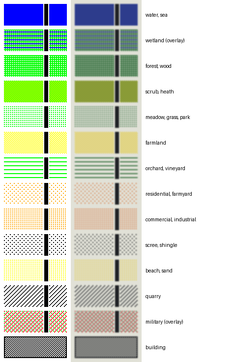
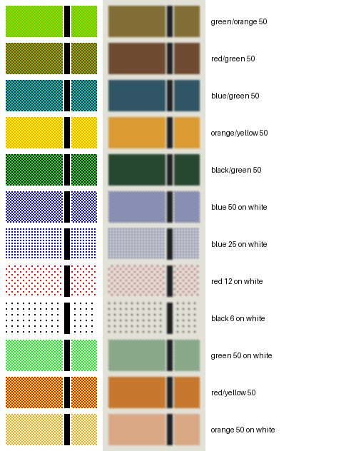
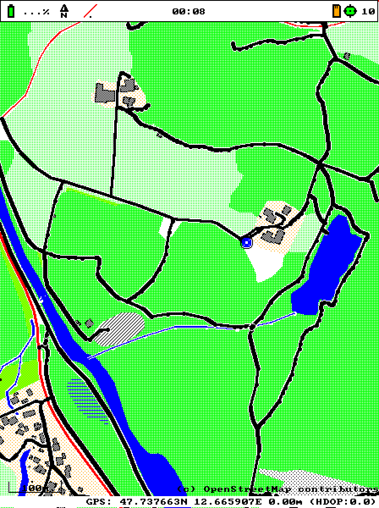
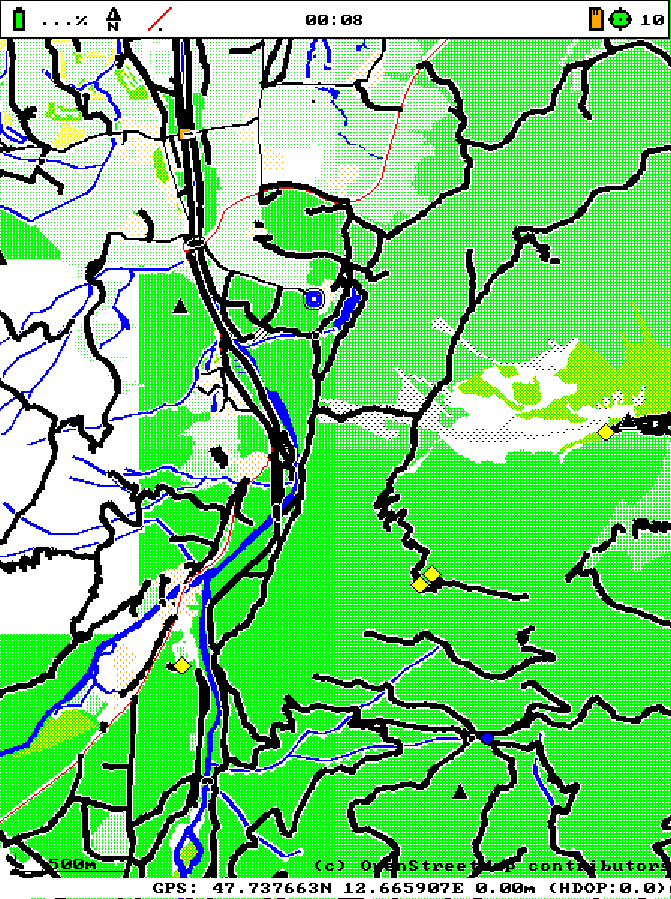
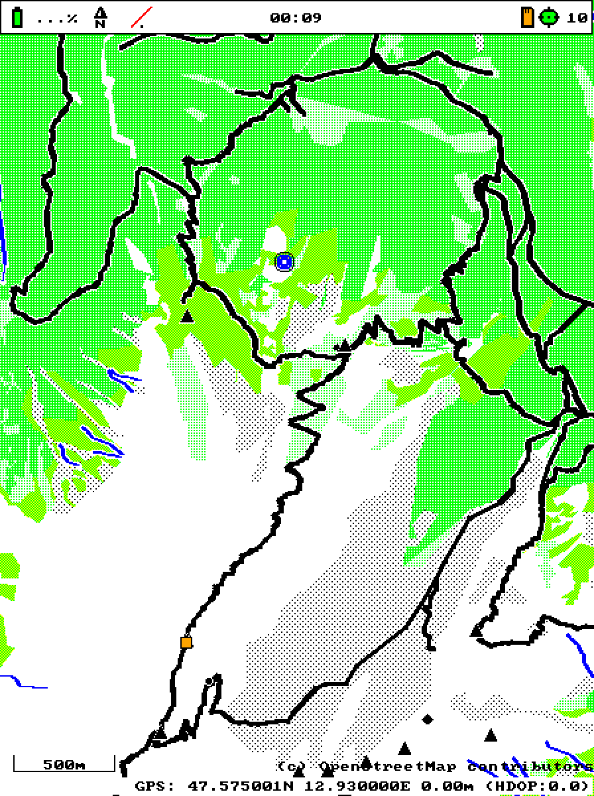
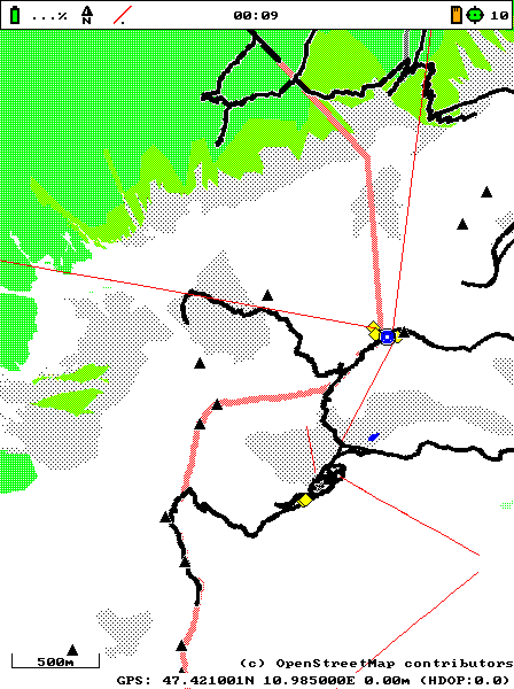
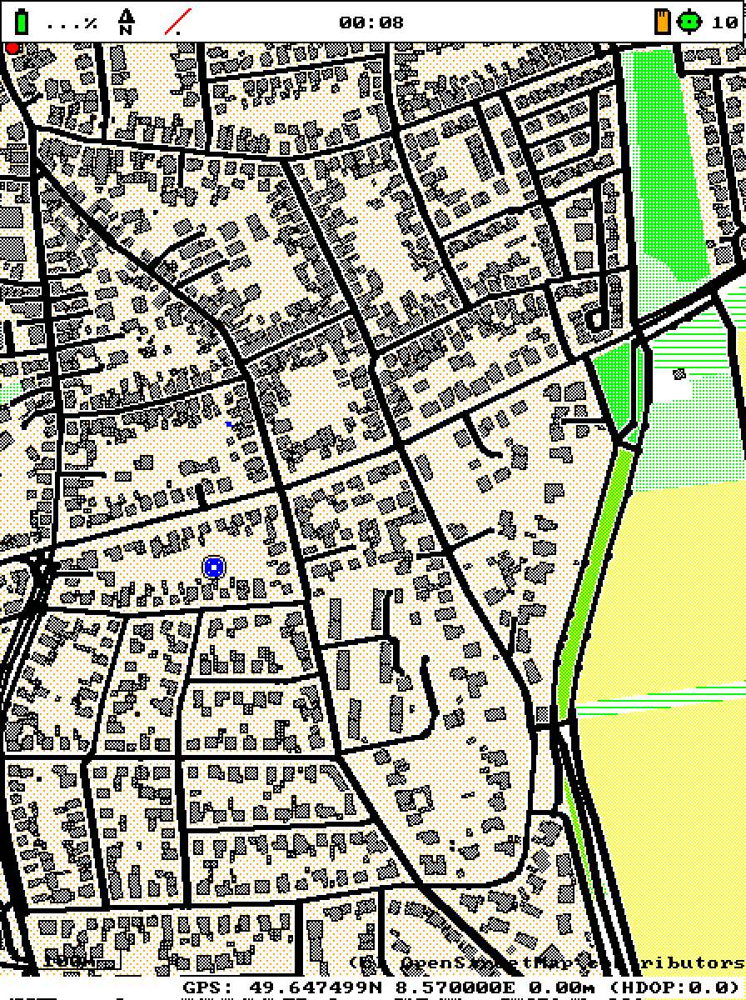
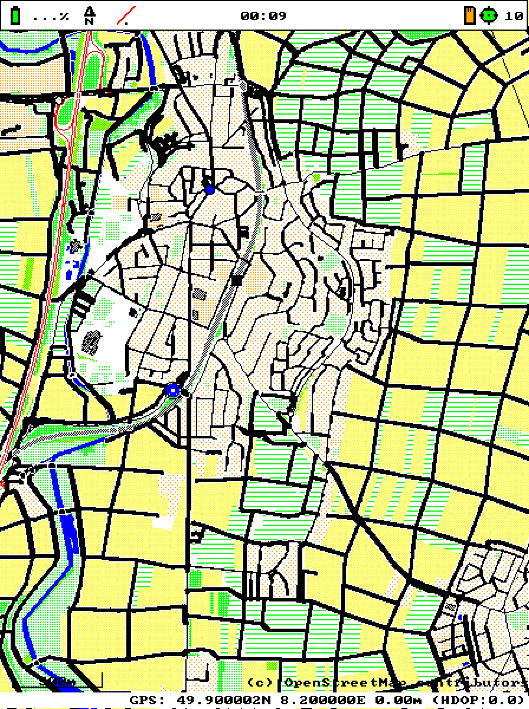
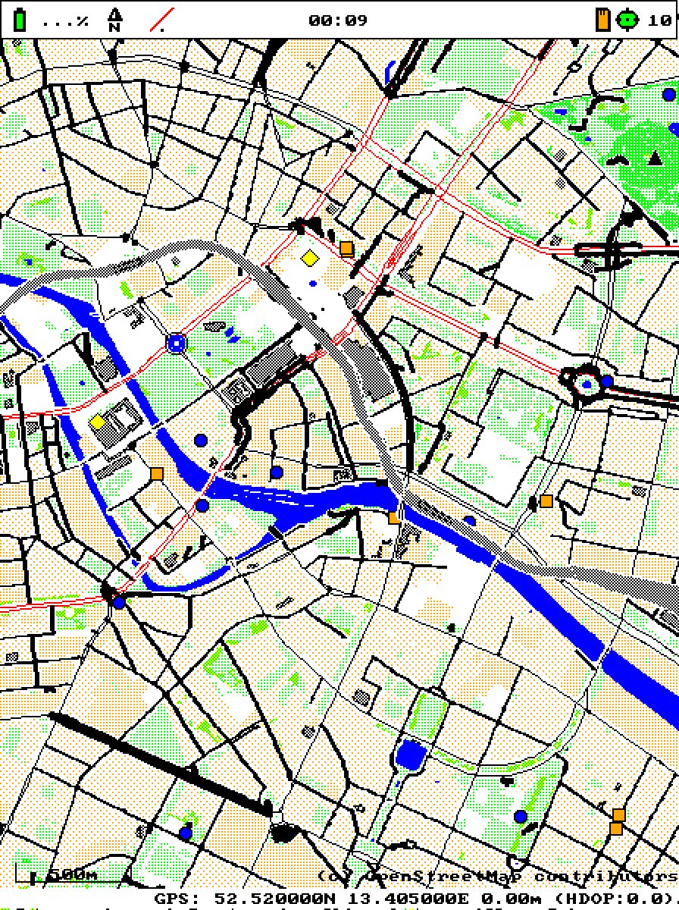
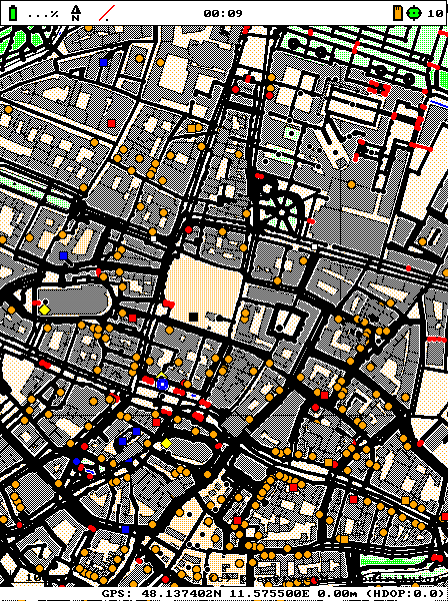

# Color schema of the hiking map (7-color e-paper)

Target: Waveshare ACeP 5.65", 600x448, about 130 dpi (1 px = 0.2 mm), inks BLACK 0, WHITE 1,
GREEN 2, BLUE 3, RED 4, YELLOW 5, ORANGE 6 (the firmware's `color_t`). White is the paper. There
is no grey and no light tint, so everything else is mixed by dithering. Map data: the official
mapsforge.org Germany map (OSM, mapsforge format v5). Implementation: `styles/hiking.style` (the rules as a loadable stylesheet, format in
`src/stylesheet.rs`; `src/style.rs` has the same as built-in default),
`src/render.rs` (casings, symbols), `c/mfr_raster.c` (patterns), encoding in
`include/mapsforge.h`.



*Area looks with a cased path on top. Left: the actual pixels at 2x, as the simulator shows them.
Right: a rough approximation of the panel (muted inks, slight blur).*

## 1. What a hiker has to tell apart, and what the data has

### What is in the Germany map

The header has 389 way tags and 102 POI tags (list them with
`cargo run --release --example tag_stats <map>`; with `<lat> <lon> <zoom>` it counts the tags in
the tiles of a view). The tags with an inline value (`%b`, `%i`, `%f`, `%h`: `height`,
`building:levels`, `roof:*`, `id`, ...) are skipped.

Used for the schema: `highway=*` (path, footway, track, steps, bridleway, cycleway, pedestrian,
living_street, residential, unclassified, service, tertiary ... motorway, `*_link`, road),
`tunnel=yes`, `bridge=yes` (via the layer), `railway=*`, `aerialway=*`, `route=ferry`,
`power=line`, `barrier=city_wall`, `waterway=*` (river, stream, canal, drain, dam),
`natural=*` (water, wetland, wood, scrub, heath, grassland, fell, scree, beach, sea, nosea),
`landuse=*`, `leisure=*`, `amenity=*`, `building=*`, `aeroway=*`, `boundary`/`admin_level`, and
POIs `natural=peak/spring/cave_entrance/volcano`, `mountain_pass=yes`, `tourism=alpine_hut/
viewpoint/information/camp_site/...`, `amenity=shelter/drinking_water/restaurant/...`,
`railway=station/halt/tram_stop`, `highway=bus_stop`, `historic=castle/monument`, ...

**Not in the data** (so not in the schema): `sac_scale`, `trail_visibility`, `surface`,
`smoothness`, `foot`, `bicycle`, `natural=bare_rock`, `natural=cliff`, `natural=glacier`,
`natural=ridge/arete`, contour lines / elevation, `waterway=riverbank`, `leaf_type`. The German
Freizeitkarte tags (`bergweg*`, `freizeitkarte=meer/land`) do not exist either; their rules are
kept for those maps. Present but not used: `tracktype=grade1..5` (says how firm a track is, not
how hard a hike is; widths and inks are already spent on more important differences),
`wood=coniferous/deciduous/mixed` (rare, and another forest look would cost a fill),
`access=*`, `motor_vehicle=*`, `piste:*` (ski runs, hidden), `boundary=protected_area`,
`leisure=nature_reserve` (hidden: huge polygons, nothing to see on the ground).

Consequences: **path difficulty cannot be shown** (a `highway=path` on the Zugspitze looks like
one in a park), and **bare rock and glaciers are white** (unmapped) - in the Alps the white
above the scree and the meadows is rock. Mountains are recognised by scree (stipple), scrub
(mountain pine), alpine meadow, peaks, huts and aerialways.

### Things to distinguish

| Group | Things |
|---|---|
| Walkable ways | paths/footways/bridleways/cycleways/pedestrian streets, tracks, steps, streets in towns (residential, living street, unclassified, service) |
| Car roads | motorway/trunk/primary, secondary/tertiary, other |
| Other lines | railways, trams, aerialways (cable car, gondola, chair lift), ferries, power lines, rivers, streams, ditches, dams, national border, city walls |
| Areas: vegetation | forest/wood, scrub/heath (mountain pine), meadow/grass/grassland/fell/park, farmland, orchard/vineyard/allotments |
| Areas: bare | scree/shingle, beach/sand, quarry |
| Areas: water | lake/reservoir/basin/river area, sea, wetland |
| Areas: settlement | residential/farmyard, commercial/retail/industrial/railway land, buildings |
| Areas: special | military (no entry) |
| POIs | peak, pass, viewpoint, cave, alpine hut, shelter, camp site/hostel/hotel, drinking water/spring, restaurant/cafe/pub, supermarket, pharmacy/hospital, station, bus/tram stop, parking, information/guidepost, picnic site, landmarks (castle, tower, church, monument, attraction) |

## 2. The mixing system

### Inks and patterns

A **paint** is ink A, a pattern and ink B (or "transparent"). Patterns are 4x4 cells anchored at
the absolute screen pixel (`x & 3`, `y & 3`), so polygons, tiles and lines that touch join without
seams, independent of where a polygon starts. Masks (`1` = ink A), rows y = 0..3, columns x = 0..3:

```
SOLID 100%   P50 50%      P25 25%      P75 75%      P12 12.5%    P6 6.25%     HLINES 25%   DIAG 25%
1111         1010         1010         1111         1000         1000         1111         1000
1111         0101         0000         0101         0000         0000         0000         0001
1111         1010         1010         1111         0010         0000         0000         0010
1111         0101         0000         0101         0000         0000         0000         0100
```

P25/P50/P75/P12/P6 are the levels of the 4x4 Bayer matrix (A where `bayer[y][x] < 16 * level`),
so they nest: every pixel of P12 is also in P25, P50 and P75. HLINES and DIAG are hatchings, which
read as a texture, not as a tint.

Mix kinds (`style::paint`): `solid(A)`, `tint(A, pattern)` = A on the background (white),
`mix(A, B, pattern)`, and `overlay(A, pattern)` = only the A pixels are painted, the fill below
stays visible (wetland on forest, military on anything).

### How the mixes look at 130 dpi (see `images/mixes.png`)

At 0.2 mm per pixel the 2x2 and 4x4 cells are below what the eye resolves at reading distance,
so P50/P25/P75 read as flat tints; P12/P6 read as a fine stipple, HLINES/DIAG as fine hatching
(0.8 mm period). Judged from renders (simulator and a panel approximation):

- **Usable**: any ink on white at 12-75% (tints: light green, light yellow, peach, light grey),
  green/yellow 50 (olive), black at 12% (grey stipple), hatchings in green, blue, black, red.
- **Not usable**: green/orange and red/green (brown mud), blue/green (dark teal, paths vanish),
  black/green or green above 75% (too dark for black lines), red/yellow and orange/yellow (look
  like orange, confusable), orange 50 (too close to residential), blue tints (look like water).
- **Reserved**: black/white 50 = buildings (user decision), solid blue = water, solid inks for
  lines and symbols.
- **Never on 1 px lines**: with a 50% pattern a diagonal 1 px line hits pixels of only one
  parity, so it is either fully drawn or invisible. Patterns are only used for fills and lines of
  3 px and more.



### Legibility of lines

- Every road and path has a **1 px white casing** on both sides, drawn for all roads of a layer
  before all road lines (order `CASING`), so crossings stay connected and black lines stand out
  from dark fills (forest is 75% green). Streams, ditches and railways get a casing too (theirs is
  drawn just below the line itself), rivers not (they lie inside water areas).
- Widths: walkable ways are thicker than roads for cars only: paths/tracks 4 px, streets 3 px,
  car roads 2 px. Below zoom 15 all roads are 1 px thinner (3/2/1) and sidewalks, service roads
  and pedestrian areas are hidden; at zoom 14 a town otherwise turns into a black mesh.
- Symbols get a 1 px ring: black around colored symbols, white around black ones (peak, pass,
  cave, landmarks) so they separate from the black paths they often sit on.
- Area fills are light (at most 75% of a mid ink), lines are solid black, red or blue.

### Draw order (within a layer; bridges and tunnels come from the layer)

| order | what |
|---|---|
| 0 / 1 | sea / land (`natural=sea`, `natural=nosea`), water tiles |
| 2 | landuse: residential, commercial, industrial, farmland |
| 3 | green: meadow, grass, park, orchard, vineyard |
| 4 | scrub, heath |
| 5 | forest |
| 6 | scree, sand, quarry |
| 7 | water areas |
| 8 | overlays: wetland, military |
| 9 | buildings (+ 1 px black border) |
| 10 / 11 | stream casings / waterways |
| 12 | national border |
| 13 | aerialways, ferries, power lines, city walls |
| 20 | casings of all roads and railways |
| 21 | railways |
| 22 | car roads |
| 23 | streets |
| 24 | paths, tracks |
| 25 | steps |
| 100 | POI symbols |

## 3. Assignment

### Areas (14 looks)

| Thing | OSM tags | Fill | Order | Rationale |
|---|---|---|---|---|
| Water, sea | `natural=water*`, `natural=sea`, `landuse=reservoir/basin`, `leisure=swimming_pool`, water tiles | solid blue | 7 (sea 0) | the only solid fill: water must never be missed |
| Wetland | `natural=wetland` | overlay blue HLINES | 8 | classic marsh hatching, keeps the forest/meadow below visible |
| Forest | `landuse=forest`, `natural=wood` | green 75% on white | 5 | strongest green, clearly darker than meadow; cased black paths stay readable |
| Scrub, heath | `natural=scrub/heath` | green/yellow 50 | 4 | olive: between forest and open land; in the Alps this is mountain pine (hard to walk through) |
| Meadow, grass | `landuse=meadow/grass/greenfield/village_green/recreation_ground/cemetery`, `natural=grassland/fell`, `leisure=park/garden/golf_course/common/dog_park/pitch` | green 25% on white | 3 | light green: open, walkable, alpine meadows too |
| Farmland | `landuse=farmland/farm` | yellow 50% on white | 2 | light yellow fields, the usual map convention |
| Orchard, vineyard | `landuse=orchard/vineyard/allotments` | green HLINES on white | 3 | rows of plants; texture instead of yet another tint |
| Residential | `landuse=residential/farmyard` | orange 12% on white | 2 | light peach: settlement, buildings stand out on it |
| Commercial, industrial | `landuse=commercial/retail/industrial/railway/construction/brownfield/landfill`, `aeroway=apron` | orange 25% on white | 2 | stronger peach: still settlement, but not homes |
| Scree, shingle | `natural=scree/shingle` (`bare_rock` if present) | black 12% on white | 6 | grey stipple = loose rock, the classic scree dots |
| Beach, sand | `natural=beach/sand` | yellow 25% on white | 6 | paler than farmland |
| Quarry | `landuse=quarry` | black DIAG on white | 6 | hatching = man made pit, steep edges |
| Military | `landuse=military` | overlay red DIAG | 8 | red hatching = no entry, over whatever grows there |
| Building | `building=*` | black/white 50 + 1 px black border | 9 | user decision; grey blocks, clearly not land cover |

Neighbours that matter are distinct by hue or texture: forest (dark green) / meadow (light green)
/ scrub (olive) / farmland (yellow) / orchard (green rows); residential / industrial differ by
density only, they are the least important pair. Unmapped land is white.

### Lines

| Thing | OSM tags | Style | Width z16 (z14) | Order |
|---|---|---|---|---|
| Path, footway, bridleway, cycleway, pedestrian | `highway=path/footway/bridleway/cycleway/pedestrian` | black, white casing | 4 (3; footway, pedestrian hidden) | 24 |
| Track | `highway=track` | black, white casing | 4 (3) | 24 |
| Steps | `highway=steps` | red, white casing | 4 (3) | 25 |
| Streets | `highway=living_street/residential/unclassified/service` | black, white casing | 3 (2; service hidden) | 23 |
| Main roads | `highway=motorway/trunk/primary(_link)` | red, white casing | 2 (1) | 22 |
| Secondary roads | `highway=secondary/tertiary(_link)` | black, white casing | 2 (1) | 22 |
| Other roads | `highway=*` (road, ...) | black | 1 | 22 |
| Railway | `railway=rail/narrow_gauge/light_rail/preserved/funicular/monorail` | black/white 50, white casing | 3 | 21 |
| Tram, miniature | `railway=tram/miniature` | black | 1 | 21 |
| Aerialway | `aerialway=cable_car/gondola/chair_lift/mixed_lift` | red | 1 | 13 |
| Ferry | `route=ferry` | black | 1 | 13 |
| Power line | `power=line` | black | 1 | 13 |
| City wall | `barrier=city_wall` | black | 2 | 13 |
| River, canal | `waterway=river/canal` | blue | 3 | 11 |
| Stream | `waterway=stream` | blue, white casing | 2 | 11 |
| Ditch, drain | `waterway=*` | blue, white casing | 1 | 11 |
| Dam | `waterway=dam` | black | 3 | 11 |
| National border | `admin_level=2` | red/white 50 | 4 | 12 |
| Runway, taxiway | `aeroway=runway/taxiway` | black/white 50 | 6 / 2 | 22 |
| Hidden | `tunnel=yes` (would look like a way on the surface), `highway=construction/raceway/services/bus_guideway`, `piste:*`, other `aerialway`, `railway=abandoned/disused/platform/subway`, `power=minor_line`, `barrier=*` (fences), other boundaries, `natural=coastline` | | | |

### POIs

Symbols are drawn as small polygons (square, diamond, triangle) through `fill_polygon`, or as
discs through `point`; the radius is in pixels. Zoom 15+ only: marked "z15".

| Symbol | Things |
|---|---|
| black triangle r4, white ring | `natural=peak`, `natural=volcano` |
| black diamond r3, white ring | `mountain_pass=yes` |
| yellow diamond r4 | `tourism=viewpoint` |
| black disc r2, white ring | `natural=cave_entrance`, `man_made=tower/windmill/lighthouse`, `historic=castle` (r3); z15: `amenity=place_of_worship`, `historic=monument`, `tourism=attraction` |
| red square r4 | `tourism=alpine_hut` |
| orange square r3 | `amenity=shelter`; z15: `shop=supermarket` |
| red square r3, z15 | `tourism=camp_site/hostel/hotel` |
| blue disc r3 | `amenity=drinking_water`, `natural=spring` |
| orange disc r3, z15 | `amenity=restaurant/cafe/pub/bar/fast_food` |
| red disc | `amenity=hospital` (r4), z15: `amenity=pharmacy` |
| black square r3 | `railway=station/halt` |
| white square r2, z15 | `highway=bus_stop`, `railway=tram_stop` |
| blue square r3, z15 | `amenity=parking` |
| yellow square r2, z15 | `tourism=information` (boards and guideposts) |
| green disc r2, z15 | `tourism=picnic_site` |

Colored symbols have a black ring. Everything else (benches, gates, places, ...) is hidden.

## 4. Implementation

**Encoding** (`include/mapsforge.h`, EINK7 palette): bits 0..7 ink A, bits 24..27 pattern id
(`MFR_PAT_*`), bits 28..31 ink B: 0 = the raster background (`mfr_raster_t.white`), 1..7 =
index + 1, 15 = transparent. A plain index is a solid color, and the old `MFR_FILL_CHECKER`
(`0x01000000`) is exactly pattern P50 with B = background, so old callers keep working. The
patterns are applied to all primitives (fills, thick and thin lines, discs).
`MFR_PATTERN_MASKS` has the masks for other rasterizers.

**RGB palette** (`MFR_PALETTE_RGB`): opaque mixes are passed pre-blended as their average color
(inks approximated by `style::INK_RGB`), with no flags; transparent overlays keep pattern and
B = 15 with A as RGB, which `c/mfr_raster.c` stipples and other rasterizers may paint solid.

**Rasterizer** (`c/mfr_raster.c`): per row the pattern gives a 4 bit mask (`mask >> 4 * (y & 3)`);
a full or empty row is one span; otherwise the majority ink of the row is one span and only the
runs of the minority ink are painted on top (transparent B: only the runs of A). The callback
`span(ctx, y, x0, x1, color)` still gets a plain palette index. Cost per pixel of a fill in span
calls: solid ~0, P75/P25 ~0.28, P12 ~0.15, P6 ~0.09, HLINES 1 per 4 rows, P50/DIAG ~0.53.
Verified pixel by pixel against the masks for all patterns, B kinds and polygon offsets.

**Rust**: `Style { kind, color: paint code, width, order, outline: Option<Ink>, casing, symbol,
min_zoom, shrink }`, built by small `const fn`s in `src/style.rs`; rules are matched once per tag
id. `render.rs` adds the casing commands, the zoom dependent widths and the POI symbols.
`DrawTarget` receives paint codes; `paint::rgb` and `paint::ink_at` decode them (used by the SVG
renderer of `tests/render_view_test.rs`).

## 5. Verification

Simulator screenshots (`tools/sim_screenshot.sh` of the firmware, shown at 2x and rotated):

| | |
|---|---|
|  Traunstein z16: forest, meadow, lake, river, wetland, quarry, streams |  Traunstein z14 |
|  Berchtesgaden z14: forest, mountain pine, alpine meadow, scree, peaks |  Zugspitze z14: scree, border, aerialways, huts, peaks (rock is white: not in the data) |
|  Lorsch z16: town, buildings, farmland |  Rheinhessen z14: farmland, vineyards, village |
|  Berlin z14: city at low zoom |  Munich z16: city centre |

Panel approximation (muted inks, blur): [Traunstein z16](images/traun16_panel.jpg),
[Berchtesgaden z14](images/koenigssee14_panel.jpg).

Speed (host, `c/example/render_ppm.c`, 600x448 EINK7, 10 renders of Munich and Berlin at z14):
0.17 s with the new schema vs. 0.19 s before. Span calls per z14 render (the cost on the ESP32,
where a span is a `display_rect_fill`):

| view (z14) | before | now |
|---|---|---|
| Munich centre | 406k | 321k |
| Berlin centre | 399k | 265k |
| Lorsch | 77k | 180k |
| Traunstein forest | 61k | 160k |
| Berchtesgaden | 30k | 111k |

Cities are cheaper (fewer lines at z14), rural views cost 2-4x more spans because the land cover
is now dithered instead of solid or white; at ~1 µs per span on the device that is 0.1-0.2 s
per render (not measured on the device).

## 6. Known limitations

- No path difficulty, no rock, cliffs, glaciers or contour lines: not in the map.
- The map ends at the German border; Austrian and Swiss terrain is empty (white).
- Some tiles of the official map lack big land cover polygons, which shows as a white rectangle
  (e.g. west of Traunstein at z14); the old style had the same gap.
- Residential vs. industrial differ only by stipple density.
- The panel colors are approximations; how the mixes look on the real panel should be checked on
  a device (the simulator shows pure X11 colors).
- Fixed pixel widths and symbol sizes; only zoom 14 and 16 were tuned.
