# Alternative styles: demo screens

Both styles are stylesheets (format in `src/stylesheet.rs`) derived from `styles/hiking.style`. Check
a file with `cargo run --example check_style <file>`.

## Black and white (`styles/bw.style`)

Only black and white inks, tints by dithering. Rendered from the Germany map with `c/example/render_ppm` (1-bit pixels, 600x448,
shown at 2x). The place names are guesses from the coordinates, the host renderer draws no labels or
icons.

Build: `cargo build --release --features ffi`, then
`gcc -Iinclude c/example/render_ppm.c c/mfr_raster.c target/release/libmapsforge_rs.a -lm -ldl -lpthread -o render_ppm`
and `render_ppm germany.map <lat> <lon> <zoom> out.ppm 600 448 eink styles/bw.style`.

| View | Image |
|---|---|
| 47.868 12.643 z16 | 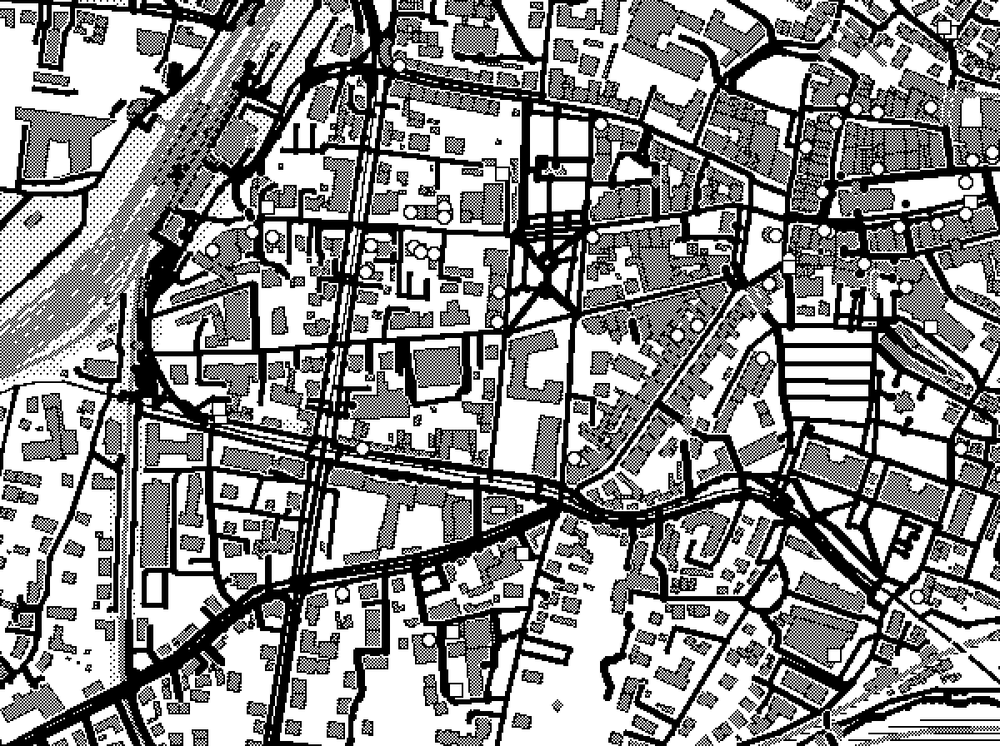 |
| 47.868 12.643 z14 | 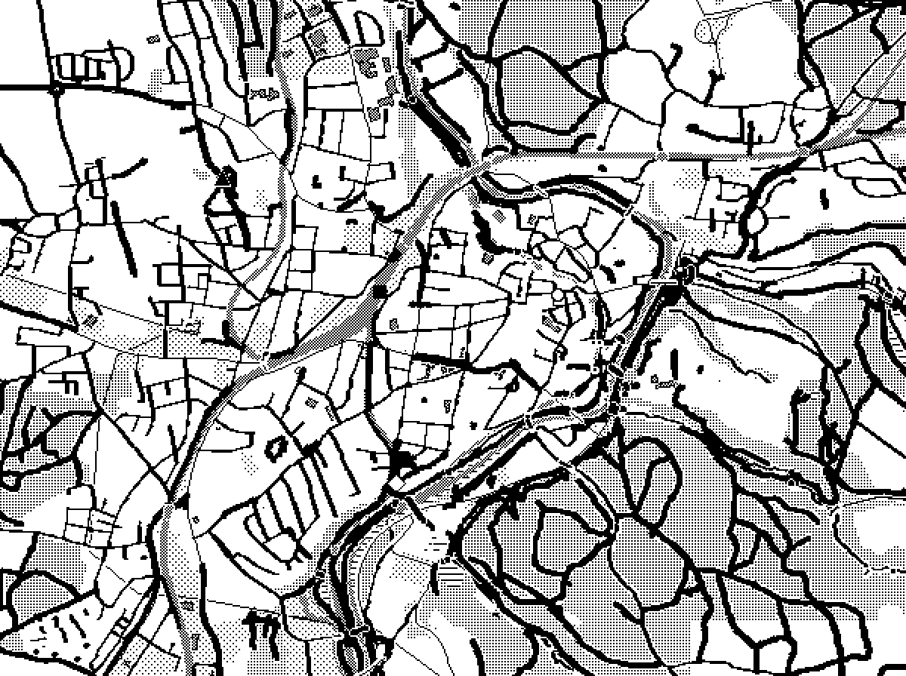 |
| 47.60 12.99 z14 (mountains) | 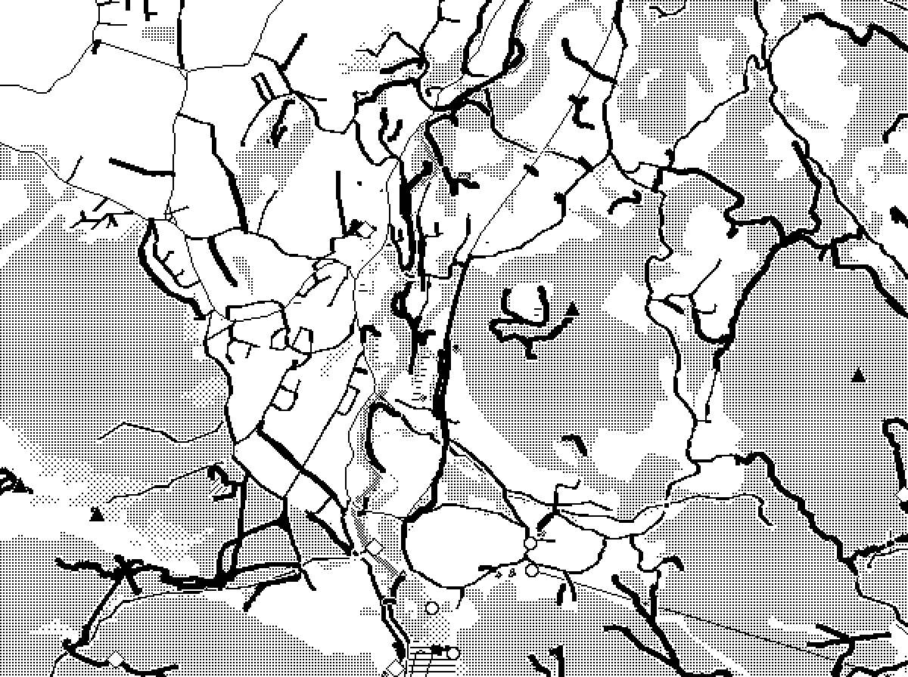 |
| 47.42 10.985 z14 (mountains) | 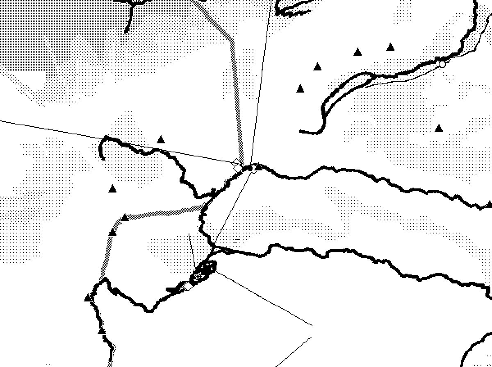 |
| 49.653 8.568 z16 (town) | 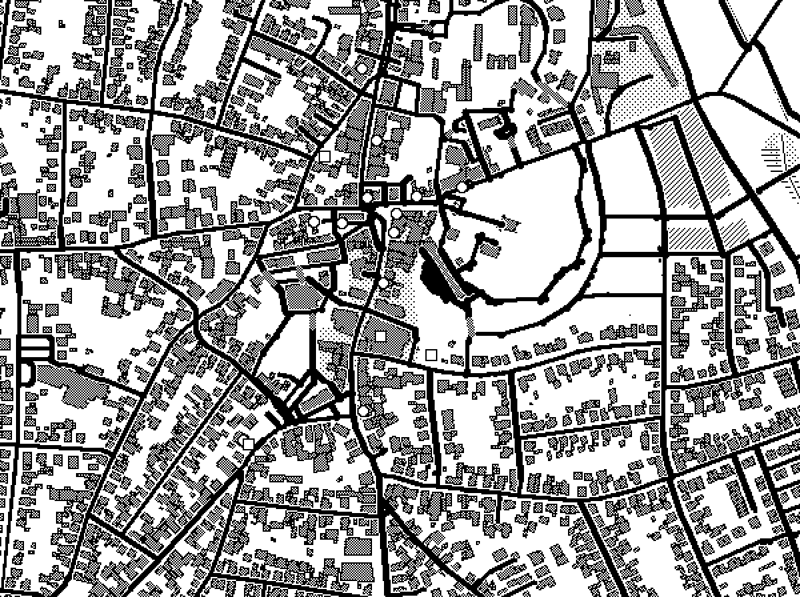 |
| 49.85 8.2 z14 (farmland) | 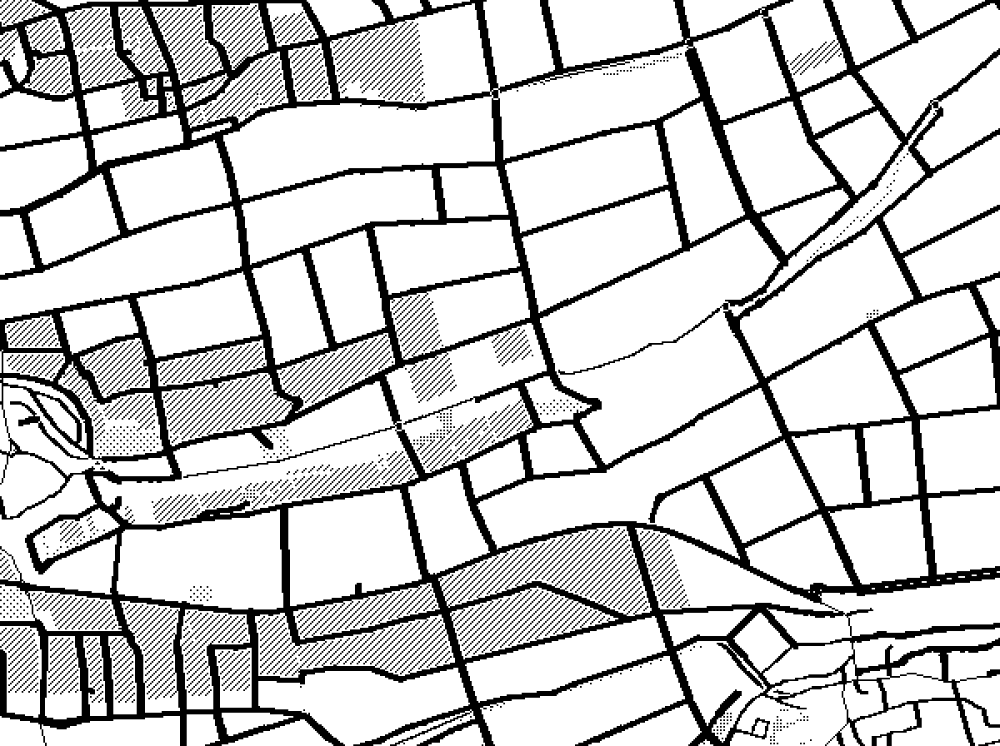 |
| 52.52 13.405 z14 (city) | 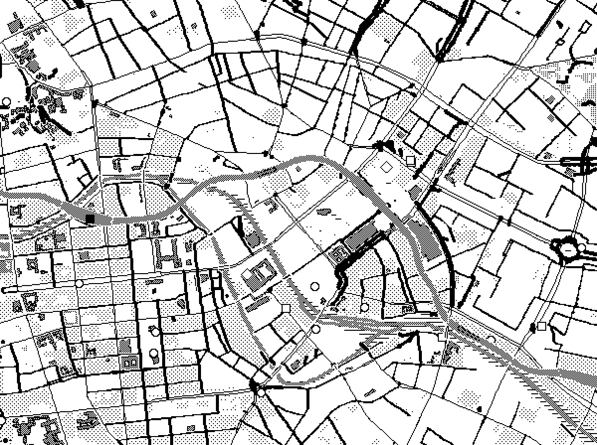 |
| 48.137 11.575 z16 (city centre) | 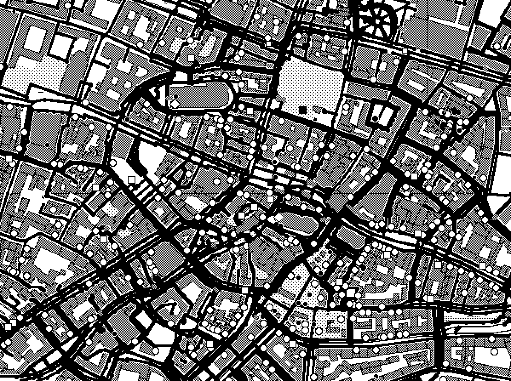 |

## Bike riding (`styles/bike.style`)

Cycleways (`cycleway`, `radweg`, `radfussweg`) are solid red, 4 px and drawn above all other lines.
Tracks and quiet streets are prominent, primary roads are orange, secondary roads black, motorways,
steps, footways and aerialways are hidden, narrow paths show from zoom 15 and service roads and
pedestrian streets from zoom 16. Fills are lighter so lines stand out, and bike shops, repair
stations, rental, parking, charging stations and benches are added as POIs. Same renderer as above,
with `styles/bike.style`; the images use the 7-color e-paper palette (`eink`).

| View | Image |
|---|---|
| 49.653 8.568 z16 (town) | 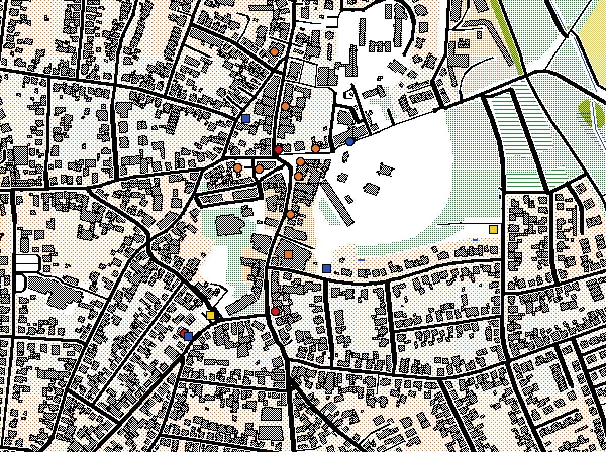 |
| 48.137 11.575 z14 (city) | 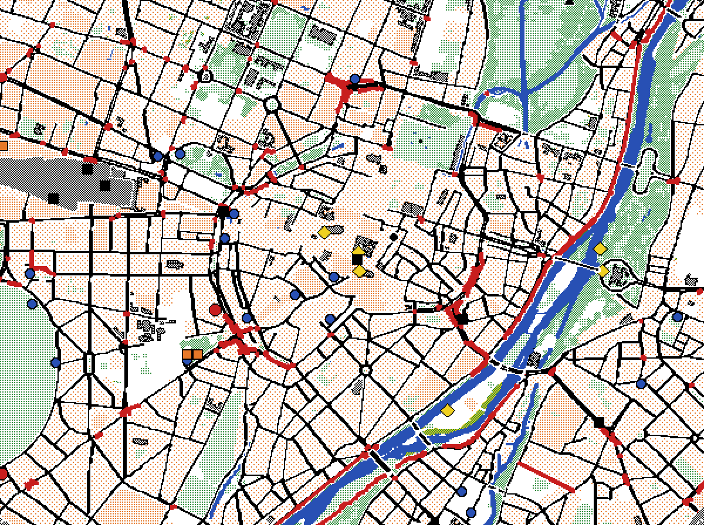 |
| 49.85 8.2 z14 (farmland) | 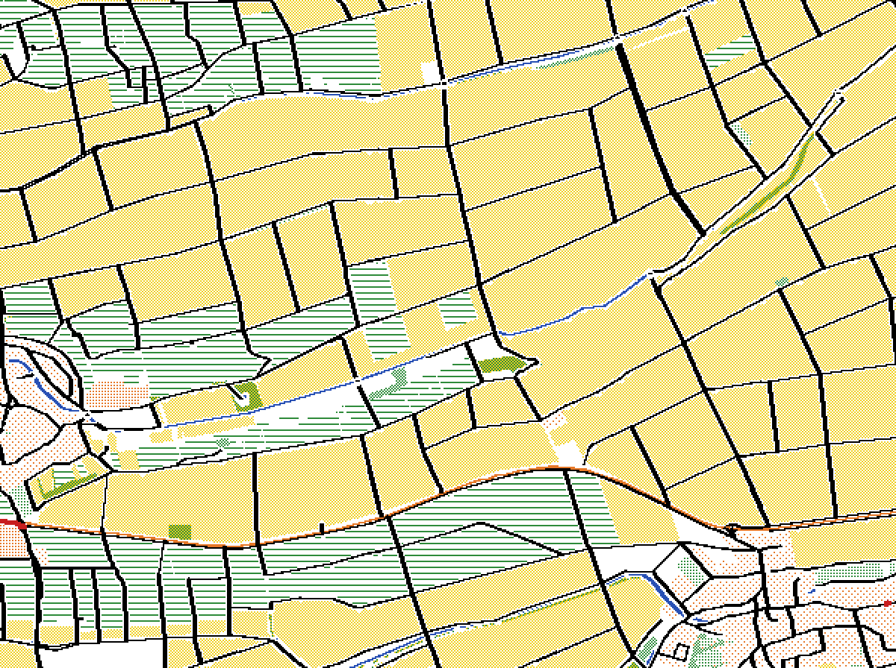 |
